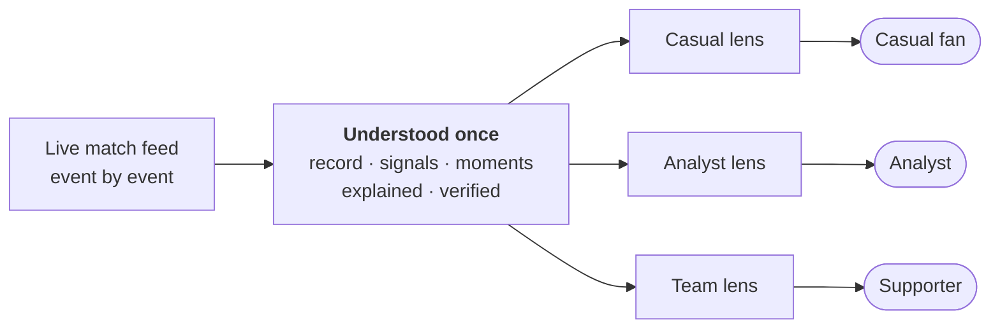
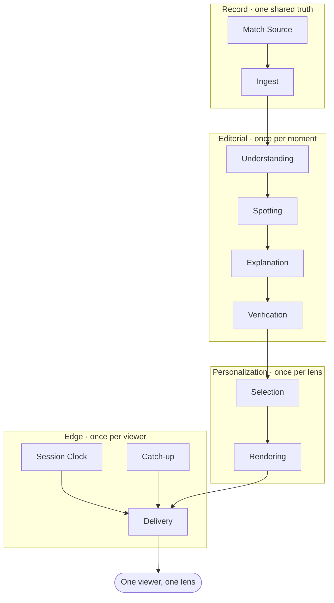

# Parallax

**A personalization layer for live football streaming.** One match is understood **once**, then told differently to a casual fan, an analyst and a supporter of one team — with every claim checked against the match record before it reaches anyone.

Solo entry to the Microsoft Premier League Hackathon ("Inside the Game").

**Live demo → https://matchlens.gentletree-f24e197c.uksouth.azurecontainerapps.io**

> **On the name:** the product is **Parallax** — the same object appears to shift depending on where you stand. The Python package, the environment prefix and the Azure resources are still called `matchlens` from an earlier name, left that way deliberately (D37).

---

## How it works

One live match goes in. Three different viewing experiences come out.



End to end, that is nine steps:

1. **Feed** — a seeded generator produces a full match, event by event, in real time. Synthetic data is what the challenge requires; the seed makes every run byte-identical.
2. **Record** — events and frames are appended to an immutable log. Everything downstream cites it by ID.
3. **Understanding** — possessions, shot quality and four team signals (territory, possession control, pressing intensity, chance quality), each measured against the match's own rolling baseline.
4. **Spotting** — goals, big chances and tactical shifts are picked out and scored for importance.
5. **Explanation** — an AI agent says *why* the moment matters, citing the events and readings it used.
6. **Verification** — six deterministic checks recompute every number against the record. A claim that fails is rejected with its reason kept.
7. **Selection** — the fan-out. Each lens decides independently whether this moment is worth telling *its* viewer. This is where one match becomes three.
8. **Rendering** — each lens gets its own words: a plain story, a tactical read, or a supporter's view.
9. **Delivery** — cards and overlays are released per viewer, on that viewer's own clock, so someone thirty seconds behind the live edge is never spoiled.

**The fan-out is at step 7, not step 1.** The match is analysed once; only the telling is per viewer. That is what makes three genuine experiences affordable, and it is why every lens inherits the same verified facts.

## The three lenses

Lenses are presets over two axes — *who the viewer follows* and *how much depth they want* — so another kind of viewer is a row in [`matchlens/lenses/lenses.json`](matchlens/lenses/lenses.json), not a new pipeline.

| Lens | Scope | Depth | What it tells you |
|---|---|---|---|
| `match_casual` | whole match | casual | The story: goals, big chances, what just changed |
| `match_analyst` | whole match | analyst | Tactical context, signals against baseline, the detail behind a moment |
| `team_engaged` | one side | engaged | One team's match, weighted to what matters to their supporter |

A viewer gets **one** lens. The demo page shows all three side by side so you can watch them diverge — including a lens sitting deliberately silent through a moment another one leads with.

## Architecture

Fourteen components in four bands. Each has a single writer, and nothing downstream of the record can change it.



- **Record** — append-only. A claim whose evidence is not an `event_id` or `reading_id` cannot be verified, so frames never reach a model.
- **Editorial** — runs once per moment, whatever the audience. The expensive thinking happens here, exactly once.
- **Personalization** — runs once per lens. Selection is model-free; only Rendering writes words.
- **Edge** — holds state per viewer: their clock, their position, what they have already been told.

Three more components sit across every band rather than inside one: **Lens Registry** (lens config is data, not code), **Control** (a producer can mute or release a lens mid-match), and **Audit** (the trail for every moment, including the claims that were rejected and the renditions that were suppressed).

Two AI agents in the whole system: the **explainer** and the **renderer**. The **verifier is deliberately not a model** — a model-based verifier would itself be unverifiable.

### If the model goes down

Rendering falls down a ladder rather than failing: model prose → template prose → nothing. Template prose through three diverging lenses still demonstrates the whole product, with zero model calls. The deployed demo has a **`Kill the model`** button in the header — press it and watch the panels keep working.

---

## Run it locally

Requires Python 3.12 and [uv](https://docs.astral.sh/uv/).

```bash
uv sync                                  # installs runtime, dev and agent groups
uv run uvicorn apps.delivery:app --reload
```

Open http://localhost:8000. No API keys, no database, no cloud account needed — with no model configured the ladder starts at template prose and everything still runs.

```bash
uv run pytest                            # the suite
uv run pytest -m slow                    # the many-match simulations
uv run ruff check . && uv run pyright    # lint and types
```

### Configuration

Everything is read in one place, [`matchlens/config/settings.py`](matchlens/config/settings.py), from `MATCHLENS_`-prefixed environment variables or a local `.env`. Copy `.env.example` to start. The ones worth knowing:

| Variable | Default | What it does |
|---|---|---|
| `MATCHLENS_MATCH_SEED` | `1` | The demo match. Same seed, same match, every time |
| `MATCHLENS_REPLAY_SPEED` | `25` | Match seconds per wall-clock second |
| `MATCHLENS_MODEL_NAME` | *empty* | Set with `FOUNDRY_ENDPOINT` to enable the agents |
| `MATCHLENS_FOUNDRY_ENDPOINT` | *empty* | Azure AI Foundry project endpoint |
| `MATCHLENS_PRODUCER_VIEW` | `false` | Serves `/producer` and `/producer/claims`; off, they return 404 |

There is **no database**. v1 needs none, because the source is a seed and the run is reproducible; a production deployment against a real feed would persist the event log, since a feed is not replayable.

### The pages

| Path | What it is |
|---|---|
| `/` | The demo: three lenses side by side, the match clock, the ladder and its kill switch |
| `/watch` | What one real viewer sees — a single switchable lens |
| `/delay` | Two viewers at different stream delays, same match |
| `/producer` | Live control: mute or release a lens mid-match |
| `/producer/claims` | Every claim and the verifier's verdict, including rejections |
| `/stream`, `/session/{id}/overlays` | The delivery API a platform would integrate |

---

## The deployed demo

One container on Azure Container Apps (UK South), playing the seeded match at 25×.

- **Full match in 3 min 47 s.** The final whistle, 94:44 of match clock, arrives 227 s after kickoff.
- **Cold start about 28 seconds** (27.8 s measured, 26 October 2026) — the container booting and generating the match from kickoff. Instant after that.
- **The verifier rejects 3 of the demo match's 51 claims.** They are visible at `/producer/claims`.
- **Public endpoints are rate limited per client.** Over the limit returns `429` with `Retry-After`; a full demo returns `503`. Sizing is in [`infra/README.md`](infra/README.md).

**The model's claims in the demo are pre-computed.** On the live path the explainer calls the model once per goal and chance, and a card waits up to 15 s for the answer inside the viewer's stream delay. A 25× replay compresses that budget 25-fold, so the demo serves the model's answers from a cache built offline over the same seed ([`matchlens/explanation/claims-cache.json`](matchlens/explanation/claims-cache.json)). The match is byte-identical from its seed, so each cached answer was given to exactly the prompt the live path would send — and every cached claim still goes through the verifier (D36).

## Microsoft and Azure technologies

| | |
|---|---|
| **Microsoft Agent Framework** | Orchestrates the two AI agents, the explainer and the renderer |
| **Azure AI Foundry** | Serves the models those agents call |
| **Azure Container Apps** | Runs the whole pipeline as one container behind a public URL |
| **Azure Container Registry** | Holds the image, pulled with a user-assigned managed identity |
| **Azure Application Insights** + **Log Analytics** | Traces, and the measured numbers above |
| **Bicep** | Every resource declared as code, in [`infra/main.bicep`](infra/main.bicep) |

CI pushes to the registry over OIDC federated credentials — no registry passwords anywhere.

## What's in the repo

```
apps/
  delivery.py          Container entrypoint: the feed, the pipeline and the web app
  pipeline.py          The stages wired in order
matchlens/
  source/              Seeded match generator, archetypes, squads, replay
  ingest/              The append-only record: events, frames, rosters
  understanding/       Possessions, shot quality, signals, baselines, epochs
  spotting/            Which moments matter, and how much
  explanation/         The explainer agent, the claim builder, the cache
  verification/        The six checks
  selection/           Per-lens: is this moment for this viewer?
  rendering/           Per-lens words, templates, overlays, the writer agent
  delivery/            Sessions, release queues, SSE, rate limits, producer view
  control/             The degradation ladder and live mutes
  audit/               The trail for every moment, including rejections
  lenses/              lenses.json — the lens presets
web/                   The pages, plain HTML and JS, no build step
infra/                 Bicep, and the deployment notes
docs/                  Architecture, data model, decisions, backlog, tickets
tests/                 Mirrors the package layout
```

## Design notes

Decisions are recorded as they were made, with their reasons, in [`docs/DECISIONS.md`](docs/DECISIONS.md) — including the ones that were reversed. The deeper reference:

- [`docs/ARCHITECTURE.md`](docs/ARCHITECTURE.md) — the fourteen components and who writes what
- [`docs/DATA-MODEL.md`](docs/DATA-MODEL.md) — the entities and their attributes
- [`docs/BACKLOG.md`](docs/BACKLOG.md) — every ticket, its tier, dependencies and status

## Not built in v1

Named rather than hidden, because each was a decision:

- **Player focus.** `Scope.PLAYER` and `focus_player` exist in the model; the lens ships as a config row once the per-player measures do (D1).
- **Defensive line height.** The one signal that needs positional frames rather than events, deferred — which is why nothing reads a `Frame` in v1 (D24).
- **Multi-language.** `Lens.language` and the lexicon are modelled; one language ships.
- **A real event feed.** The pipeline consumes a stream; swapping the generator for a live feed means persisting the record, since a feed cannot be replayed from a seed.

## What Parallax explains next

A viewer can see a goal. What they cannot easily see is what caused it. v1 explains moments from four team-level signals; next, in order:

1. **How a goal came about** — who gave the ball away and where, how fast it was punished, where the shot came from. Every fact countable from the event log, so it stays verifiable.
2. **What changed after a substitution or a red card** — comparing the stretch before with the stretch after. Parallax will say *since*, never *because*: a timing it can check, not a cause it cannot.
3. **Shape and style** — width, crossing, a team's attacking pattern, and what changes when a particular player comes on.

Throughout, a viewer is never shown a calibrated value: no shot rating, no standard deviations. Cards say "a hard chance" and "pressing much harder than their norm", and show only counts, percentages and metres.
