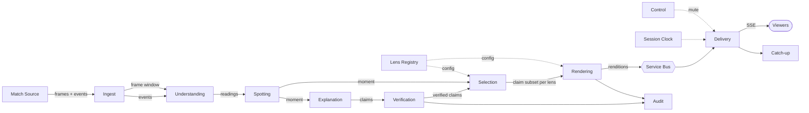

# Architecture

**Style: event-driven streaming pipeline** — pipes and filters over an unbounded stream, with event sourcing at the base, fan-out at selection, stateful edge delivery, and agentic middle stages.

Explicitly **not** n-tier/layered, not microservices, not request/response, not batch/ETL, not pub/sub. Saying which it is not matters: the obvious instinct is to build this as layers, and layers ship nothing observable for two weeks.

---

## The 14 components

Each responsibility is one sentence. An "and" in it is a **smell, not a crime**: when you find one, ask whether the two halves can fail independently and be tested separately. If they can, split the component. If one half is a consequence of the other, rewrite the sentence — do not just delete the word. A rule that bans a conjunction is satisfied by deleting the conjunction, which hides the second job instead of removing it.

| # | Component | Responsibility |
|---|---|---|
| 1 | **Match Source** | Produces a deterministic stream of frames and events from a seed |
| 2 | **Ingest** | Holds the recent frame window in memory and enforces the frame access boundary |
| 3 | **Understanding** | Turns the raw stream into derived measures — possessions, shot quality, signal readings |
| 4 | **Spotting** | Decides which measured changes are worth saying something about |
| 5 | **Explanation** | Produces structured claims for a moment from a log frozen at that clock |
| 6 | **Verification** | Checks each claim against the untouched record and returns a verdict |
| 7 | **Selection** | Chooses which verified claims one lens shows |
| 8 | **Rendering** | Turns one lens's selected claims into a rendition |
| 9 | **Catch-up** | Summarises what a lens would have shown before a viewer joined |
| 10 | **Delivery** | Releases each rendition to a session when that session's clock reaches it |
| 11 | **Session Clock** | Tracks where each viewer is in the match |
| 12 | **Lens Registry** | Serves lens configuration as data |
| 13 | **Control** | Applies producer interventions to subsequent cards |
| 14 | **Audit** | Records what was said and how it held up |

**Components 2 and 3 keep their "and" deliberately.** Ingest's enforcement is a *consequence* of exclusive ownership, not a second job — split it and you get a gatekeeper wrapping a buffer that anything can bypass by calling the buffer directly. Understanding's list is objects, not verbs: one transformation over three quantities is one responsibility.

**Components 7 and 8 were one component called Personalization until D17.** Selection and Rendering fail independently, test separately, and sit on opposite sides of the model boundary — see D17 for why that matters.

---

## How data moves

**The twelve steps in words:**

1. Match Source emits a frame at the configured rate and events as they occur, both carrying `seq` and `clock_ms`.
2. Ingest accepts them, keeps frames in a memory window, and persists events. **Ingest is the single writer of `Frame` and `Event` (D18)** — Match Source produces, Ingest writes.
3. Understanding derives possessions and shot quality from events, and line height and compactness from the frame window.
4. Understanding emits `SignalReading`s on a rolling cadence, each carrying `baseline`, `z_match`, `z_prior`, `confidence` and `epoch_id`.
5. Spotting compares readings against thresholds, scores importance, applies cooldown and duplicate suppression, and emits a `Moment` citing what fired it.
6. Explanation takes the moment, reads a log **frozen at that moment's clock**, and emits `Claim`s — never prose.
7. Verification runs the six checks per claim, recomputes values independently, and persists a `Verification` per claim. Fails closed.
8. Selection takes the moment plus its passing claims. For each lens: dispatch on `scope`, apply `importance_threshold` and `
`, filter by `allowed_claim_types`. The output is a claim subset per lens — **never text, and never a model call**.
9. Rendering turns each lens's subset into a `Rendition` — **including `suppressed=true` ones**, which are records, not absences. A lens whose subset came back empty still gets a rendition, carrying the `suppression_reason` Selection resolved.
10. Renditions go onto the broker, partitioned by `match_id`.
11. Delivery holds each rendition in a per-session queue and releases it when `display_at_clock <= match_clock_now - stream_offset_ms` for that session.
12. The viewer's browser receives it over SSE and renders a card.

---

## Data ownership — single writer per entity

Eight components write to storage. Without a rule this becomes an integration database, where every component reads and writes every table and nothing can change safely.

**The rule: exactly one component writes each entity.** Everyone else receives it on the stream.

| Entity | Written by |
|---|---|
| `Match`, `Team`, `Player`, `Frame`, `Event` | **Ingest** (D18) |
| `Possession`, `ShotValue`, `SignalReading`, `Epoch` | Understanding |
| `Moment` | Spotting |
| `Claim` | Explanation |
| `Verification` | Verification |
| `Rendition`, `OverlayPacket` | Rendering |
| `ViewerSession` | Delivery |
| `ProducerAction` | Control |
| `Lens`, `SignalPrior`, `MatchArchetype` | Control / offline scripts |

**Selection writes nothing.** It hands a claim subset to Rendering in process, and `Rendition` is written once, by Rendering. This is what makes the split cheap rather than a second storage boundary to police.

**Match Source is not a writer.** It was listed as one ("Match Source (via Ingest)"), which named two components for one entity and quietly broke the single-writer rule the table exists to state. Source produces a stream; Ingest is the sole custodian of the raw record, whether that record is an ephemeral frame window or a durable event log (D18).

**Most "reads" are not storage reads.** Data arrives on the stream. There are only three legitimate reasons to read from storage:

1. **The frozen log** — Explanation reading events strictly before a clock.
2. **History** — Catch-up and recap reading moments and renditions for a window.
3. **Configuration** — anything reading the Lens Registry or priors.

Anything else that wants a storage read is probably a missing stream message. Stop and ask.

---

## Boundaries

- **Frames stop at Understanding.** Nothing downstream of Understanding may read a `Frame`. This is the boundary with a test on it.
- **The record / editorial line sits between Understanding and Spotting.** Everything upstream is a faithful record; everything downstream is an opinion.
- **Verification sits between Explanation and Selection** so that no unverified claim can reach a renderer.
- **Every model call lives in Rendering. Selection is model-free.** A model outage can change how a card reads; it can never change which claims a lens shows. The degradation ladder therefore runs entirely inside Rendering (D17).
- **Archetypes stop at Match Source.** Nothing downstream may read `Match.archetype_id` or `Match.seed`. They are provenance, a real feed leaves them null, and a component that branches on them is untransferable while still passing every test (D25).
- **Lens config is read, never written, by Selection and Rendering.**

---

## Deployment

**v1 deploys one container (D23), and S5 shipped it.** All fourteen components run in a single process entered through `apps.delivery`, which runs the seeded replay and the pipeline in-process as it has locally since S4.

What is actually deployed, from one Bicep file into one resource group:

| Resource | Shape |
|---|---|
| Container app `matchlens` | One image, one entrypoint, public ingress on 8000, **scale 0–1**. X4 raises min replicas to 1 for the judging window |
| Container registry (Basic) | Pulled by a user-assigned identity holding AcrPull |
| Log Analytics + Application Insights | Where traces land (S6) |
| GitHub Actions via OIDC | A federated Entra app with Contributor on the group and AcrPush on the registry. No stored secrets |

**Service Bus is not on the path in v1**, and why the two-unit split was abandoned is worth keeping: the pipeline app receives no HTTP traffic, so scaled to zero it never starts and no match plays. A viewer's request now wakes the single container, which starts the match — so a cold start regenerates from kickoff, and that delay is documented rather than hidden.

`apps/pipeline.py` stays in the image. The `Card` contract (`publish`, `CardRouter.receive`) is unchanged, so splitting later swaps an in-process `publish` for a Service Bus sender and nothing else moves.

### The split v1 does not do, and why it will matter

The boundary is still real: the slow agentic path and the fast session-oriented path have genuinely different scaling characteristics.

| Later unit | Components | Shape |
|---|---|---|
| **Pipeline app** | Match Source, Ingest, Understanding, Spotting, Explanation, Verification, Selection, Rendering, Catch-up, Lens Registry | CPU and model bound, bursty |
| **Delivery app** | Delivery, Session Clock, Control | Connection bound, stateful per session |
| **Audit function** | Audit | Event-triggered, post-match, nobody waits for it |

**The GIL argument now cuts the other way.** This section used to claim the two-container split solved it. In v1 it does not: CPU work and connection I/O share one process, so a long signal computation can delay a release. That is acceptable here — one match at 25× replay does not saturate a core — but it is a live constraint of the v1 shape rather than a solved problem, and the split is the fix when a second match arrives.

---

## Scaling, for the pitch only

Not build work. One match, one pipeline, one container.

- **One pipeline worker per match**, partitioned by `match_id` — nearly all pipeline state is per-match (ring buffers, rolling windows, baselines, epochs, suppression lists) and no two matches share anything.
- **Renditions are per match × lens, not per viewer.** Twenty matches × three lenses = 60 streams, whether ten people watch or ten million. A viewer costs a connection, not a computation.
- **The real cost driver is Explanation**, which scales with matches × moments and runs whether anyone is watching.

The full version lives in the Notion Infrastructure page under "Scaling in production".

---

## Observability

One trace per moment, spanning spotter → explainer → verifier → selection → rendering, with `moment_id` as a trace attribute and timings on each span.

A screenshot of that waterfall is evidence of orchestration that no amount of prose achieves: it shows the agents are genuinely separate, genuinely sequential, and genuinely handing work to each other.
